<strong> Teresa Archive </strong>

Dit is mijn digital garden voor het vak Het web is voor iedereen. Op mijn website SKYPIA / Teresa Archive verzamel ik mijn interesses, afbeeldingen, danswerk en experimenten met HTML, CSS en JavaScript. In deze README houd ik mijn leerproces, opdrachten, feedback en code-uitleg bij.

Mijn Learning Log
De Learning Log staat hieronder. Net als in het voorbeeld zijn de onderdelen per les of opdracht open- en dichtklapbaar gemaakt, zodat de pagina overzichtelijk blijft. De deepdives, code-uitleg en bronnen staan onderaan.

<strong>Gebruikte bronnen en hulpmiddelen</strong>

Inhoudsopgave
- 26 okt - Expo en afronding
- 23 okt - Voortgang en retrospective
- 21 okt - Bi-weekly geek 3
- 19 okt - Planning en voortgang
- 9 okt - Workshop en voortgang
- 7 okt - Workshop
- 5 okt - Sprintplanning en workshop
- 2 okt - Voortgang en retrospective
- 30 sept - Toegankelijkheid en WCAG
- Responsive website
- 1 okt - Light en dark mode
- Foto's rondom de CD
- Boogtekst
- Proces en iteraties
- 18 sept - Retrospective
- Visual research
- 16 sept - Workshop
- 14 sept - Workshop
- 7 sept - Workshop 1
- 2 sept - HTML en CSS
- 31 aug - Kick-off
- Deepdives en oefeningen
  - Light en dark
  - Grid
  - Gradients
  - Button
- Code-uitleg voor mijn website
- Bronnen

 

<strong>26 okt - Expo en afronding</strong>

Vandaag was de EXPO en afronding van het eindproject: 

Reflectie: 

Als ik terugkijk op dit blok, heb ik veel geleerd over HTML en CSS. In het begin vond ik het lastig om keuzes te maken voor mijn Digital Garden. Ik had verschillende ideeën, maar wist niet goed hoe ik deze wilde uitwerken en welke vormgeving het beste bij mij paste.

Door de deepdives heb ik nieuwe dingen geleerd, zoals Grid, responsive design, media queries, light/dark mode, animaties en variable fonts. Ook heb ik meer geleerd over toegankelijkheid en privacy. Ik heb hierdoor veel nieuwe dingen kunnen uitproberen en ben beter geworden in het zelf oplossen van problemen.

Ik ben nog niet helemaal tevreden met het eindresultaat, vooral als het gaat om wat ik er nog bij kopn toevoegen. Toch ben ik blij dat alles werkt en dat ik een website heb gemaakt die simpel blijft, maar wel mijn persoonlijkheid laat zien. De feedback van docenten en klasgenoten heeft mij geholpen om te zien wat ik nog kon verbeteren.

Uiteindelijk vond ik het een leuk en leerzaam blok. Ik ben minder bang geworden om nieuwe dingen te proberen en heb geleerd dat niet alles meteen perfect hoeft te zijn. Ik ben blij met wat ik heb bereikt en sluit dit blok met een best goed gevoel af!

Verder heb ik in het formulier met - en + aangegeven wat voor feedback ik had terug gekregen van Twan over 'hoe webby mijn eindwebsite is'. 

-
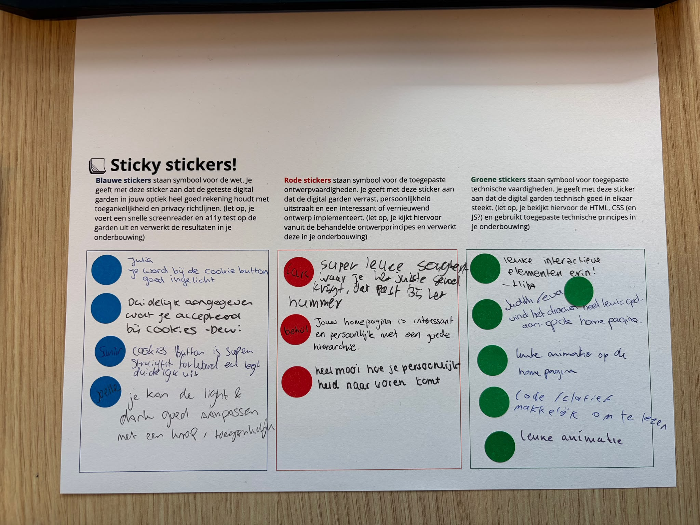
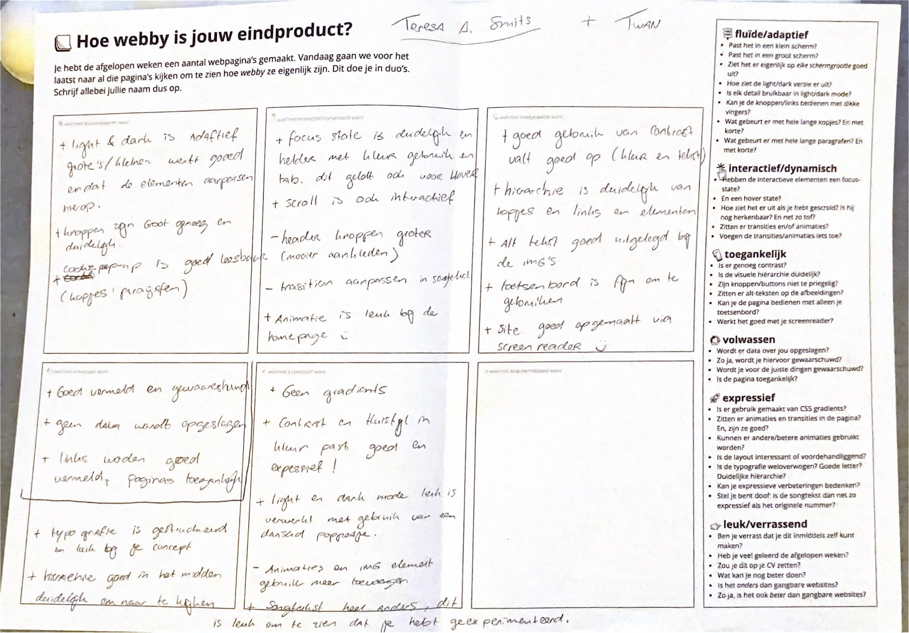
-

 

<strong>23 okt - Voortgang en retrospective</strong>

Vandaag was de laatste retrospective en heb ik op basis van de feedback van Nicky kwam ik op het idee om animaties toe te voegen die passen bij het gevoel van Freezing. 

- Shake-effect: FREEZING trilt alsof iemand het koud heeft.
- Groei-animatie: belangrijke woorden worden langzaam groter en helderder.
- Blur-effect: zachte tekst wordt kleiner en waziger.

Zo versterken de animaties de sfeer van het nummer
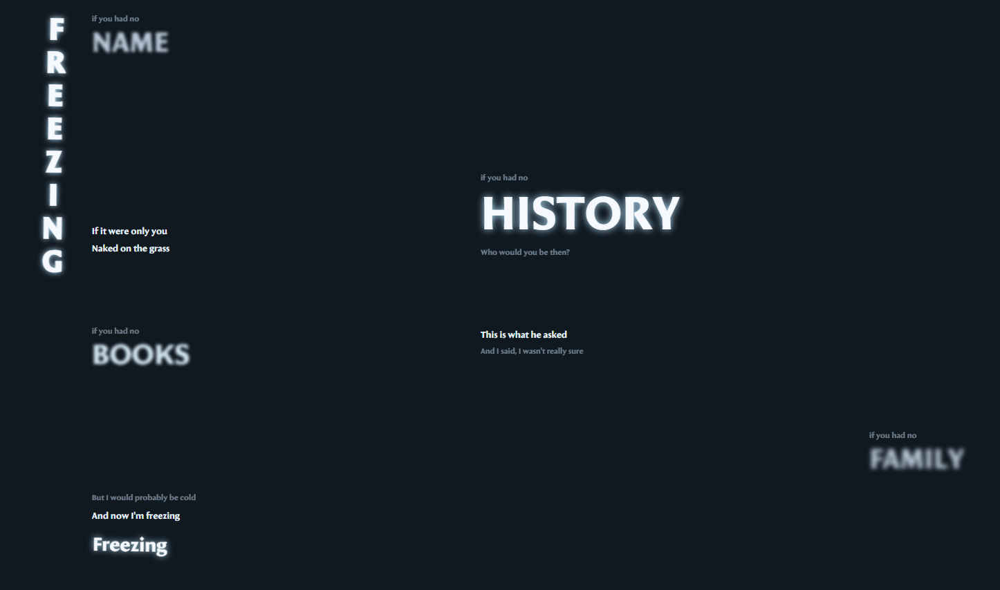

Verder had ik ook feedback gekregen om mijn cookie inhoud uit te breiden dus dat heb ik gedaan.
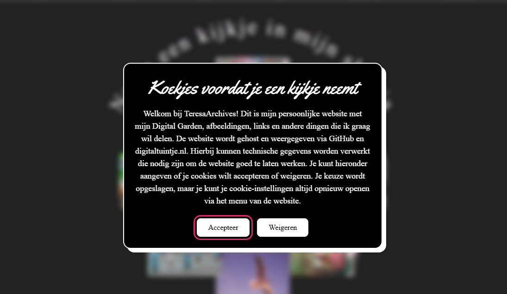

-

<strong>19 okt - Planning en voortgang</strong>
 

Vandaag zijn we in duo's met de randominazor ingedeeld. Je gaat met zn 2 kijken naar elkaars website en het webby formulier invullen

Ik had zelf wat feedback aan mijn klasgenoot Esmee gegeven en verder feedback van haar gekregen:
- Cookieknop terug te vinden in menu
- Links tab afmaken 
- songtekst experiment linken aan mijn website
- Wanneer ik alles had toegepast dat mijn light & dark mode het nog volledig goed deden

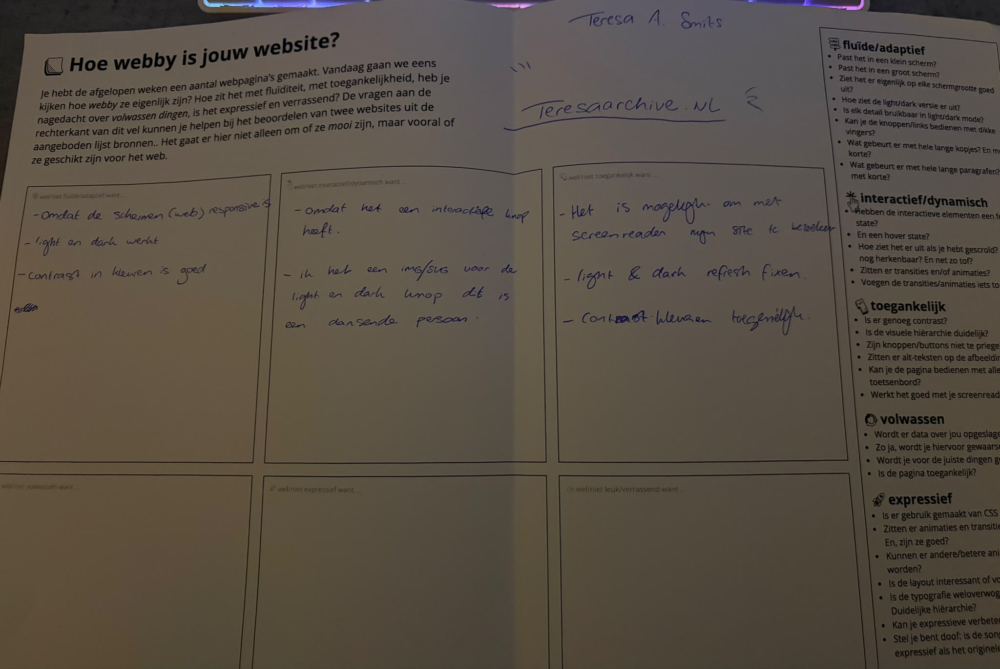

<strong>5 okt - Sprintplanning </strong>
 

We moesten in groepjes de artikel over layout bespreken en samenvatingen van maken, ik heb dit opgeschreven met mijn klasgenoot en dit moeten presenteren voor de klas.
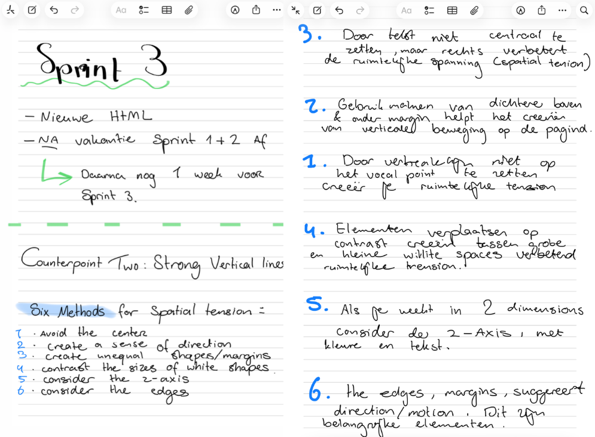

Verder hadden we een wokrshop over songtekst en layour hiervan en heb ik het lied freezing gekozen om me heir in teverdiepen en schesten van gemaakt.

<strong>2 okt - Voortgang en retrospective</strong>
 

Vandaag hadden we de 2de retrospective deze keer voelde een stuk beter, omdat ik veel aan mijn site had gewerkt met behulp van de deepdives! We moesten aan de hand van toegankelijkheid de websiete te testen en ik had heirvoor een spiekbriefje gemaakt. Dit was allemaal gelukt! verder had ik feedback gekregen om mijn light en dark mode aan te passen op alle tabs en dit is gelukt met behulp van een eindejaars student. 

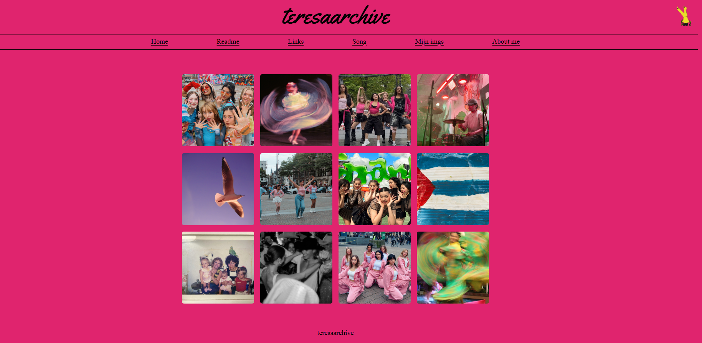
-

<strong>30 sept - Toegankelijkheid en WCAG</strong>
  

Check out met Dewi

1. A11y accessibility en WCAG Web content Accessibility Guidelines
2. Screen reader, ik moet hier nog meer oefenen
3. Contrast (kleur), goede contrast kleuren aanpassen

Ik ben verder gegaan met het toegankelijk maken van mijn website. Ik heb mijn website gecontroleerd aan de hand van de WCAG-checklist. Hierbij heb ik gekeken naar onder andere content, globale HTML-code, keyboard navigation, mobile en touch, headings, lists, images en controls.

Ik heb verschillende verbeteringen aangebracht. Zo heb ik een skip-link toegevoegd, focus-states voor interactieve elementen toegevoegd en ervoor gezorgd dat de website met alleen het toetsenbord te bedienen is.

Ook heb ik prefers-reduced-motion toegevoegd. Hierdoor wordt de animatie van de foto's uitgeschakeld voor gebruikers die minder beweging willen.

Daarnaast heb ik gekeken naar de alt-teksten van mijn afbeeldingen en naar de structuur van headings, links en buttons.

<strong>27 sept - Biweekly Geek 2</strong>
 

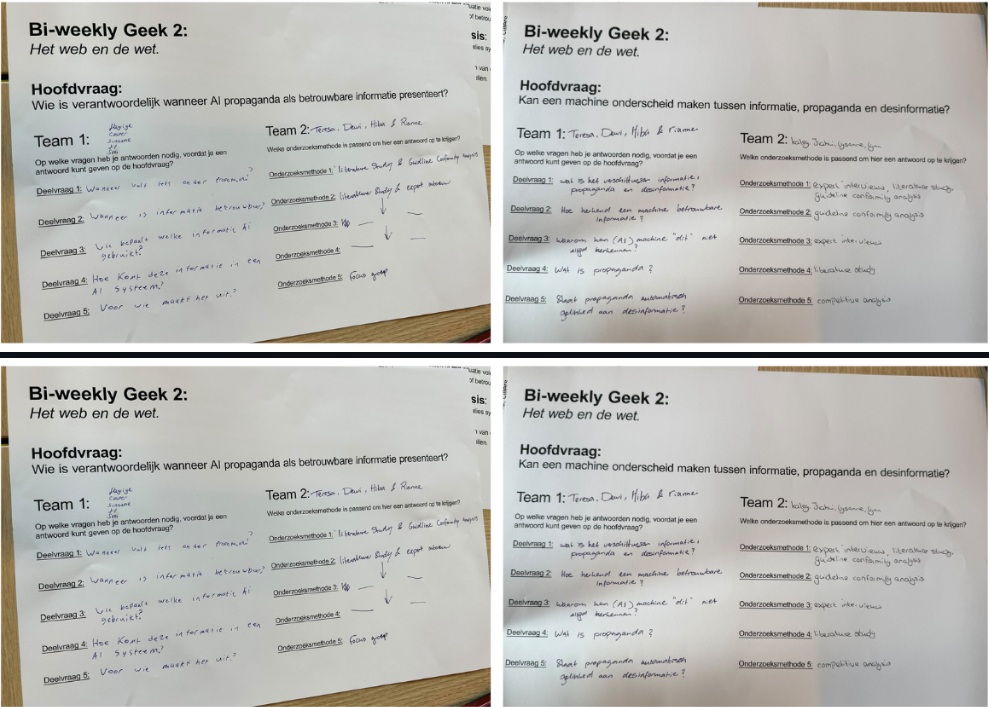

<strong>25 sep - Compliance/ valide</strong>
  

Vandaag de compliance van mijn webisite gechecked en er waren maar 2 dingen die aangepast moesten worden dus ik heb dit gedaan + mijn cookie popup gemaakt.

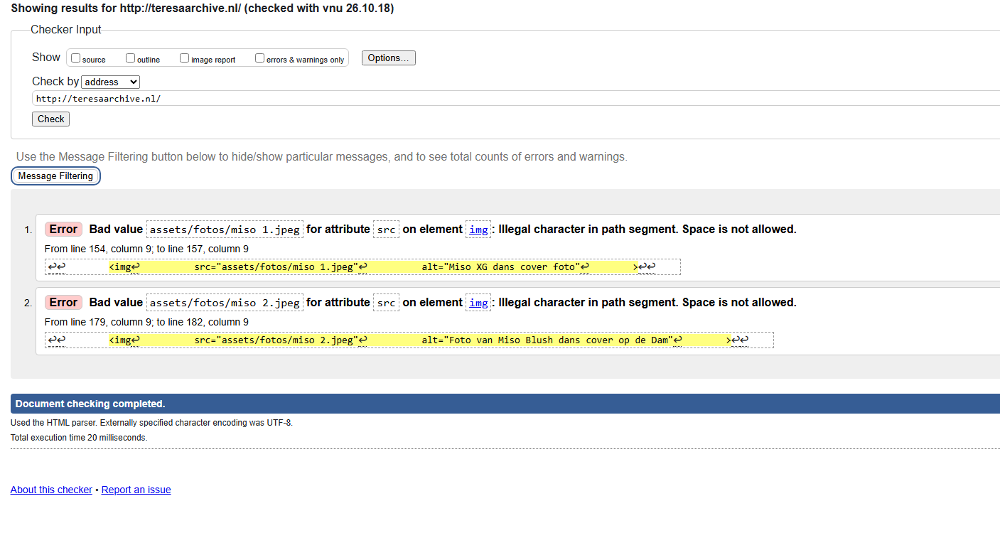

<strong>22 sep - Dark Paterns artikel</strong>
 

<strong>18 sept - Retrospective 1 </strong>
 

Ik was vastgelopen omdat ik een te lastig idee had. Tijdens de retrospective kreeg ik feedback om de opdracht kleiner te houden.

Ik ben daarom verder gegaan met een versimpelde en responsive versie van mijn website. Ook ben ik gaan werken aan een light/dark mode.

Charley en Kate

<strong>16 sept - Workshop</strong>
 

Schetsen: grid en idee

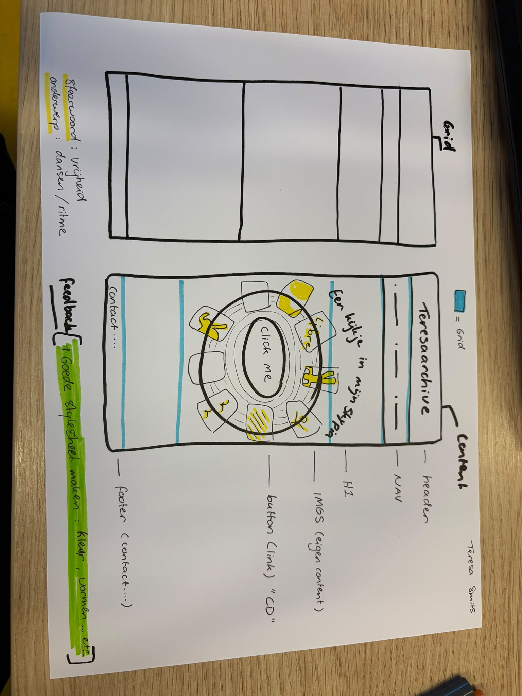
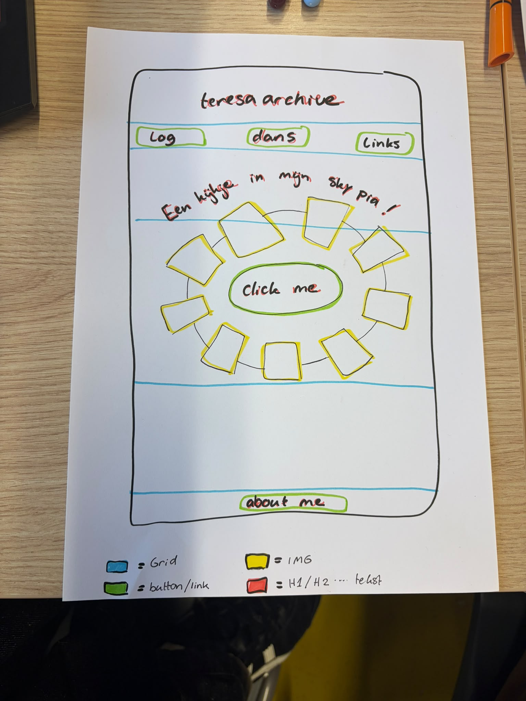
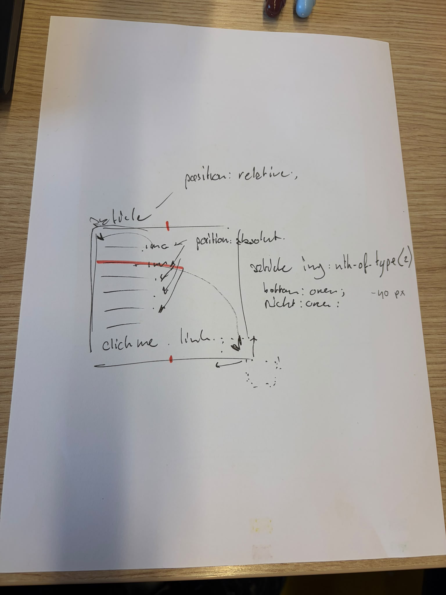

Check-out met Giel
1. Noem drie Gestalt- of designprincipes en leg uit wat ze betekenen.
Mijn voorbeelden waren balans, visuele hiërarchie en contrast. 
2. Een grid biedt ruimte om te spelen, maar geeft tegelijkertijd eenheid en structuur.
3. Welk principe neem je mee in een laatste iteratie van je eigen digital garden?
Ik wil contrast en witruimte beter gebruiken.

## Visual research

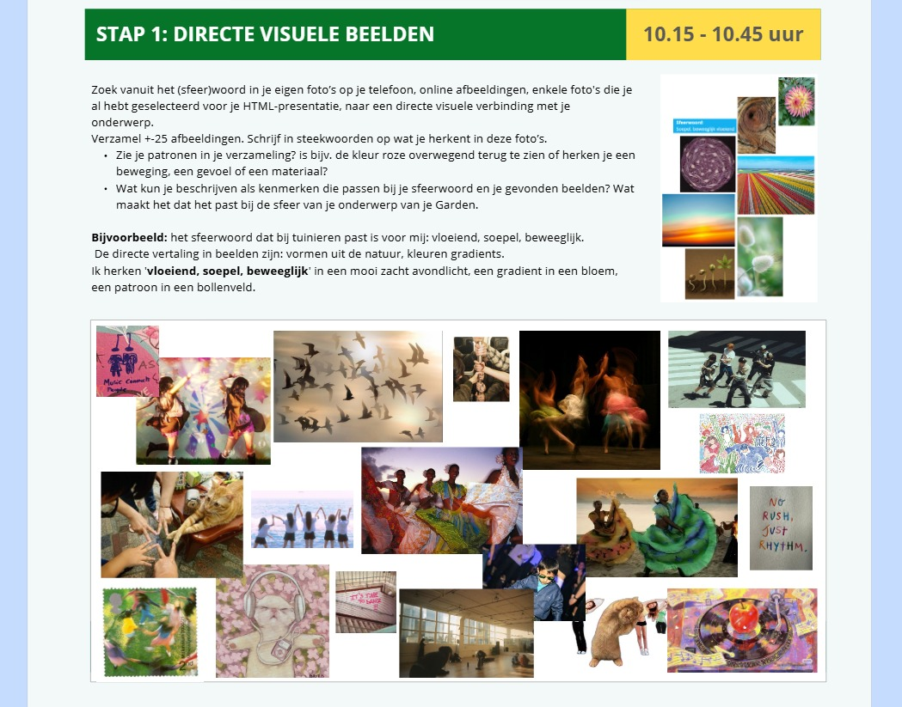

### 14 sept - Workshop

- Bi-weekly groepsopdracht
  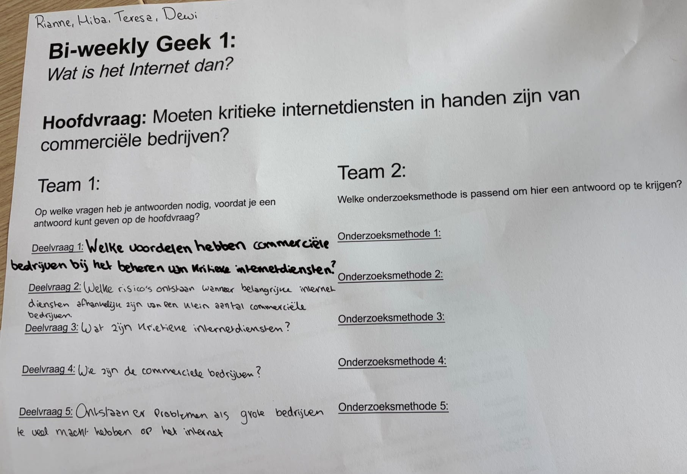
  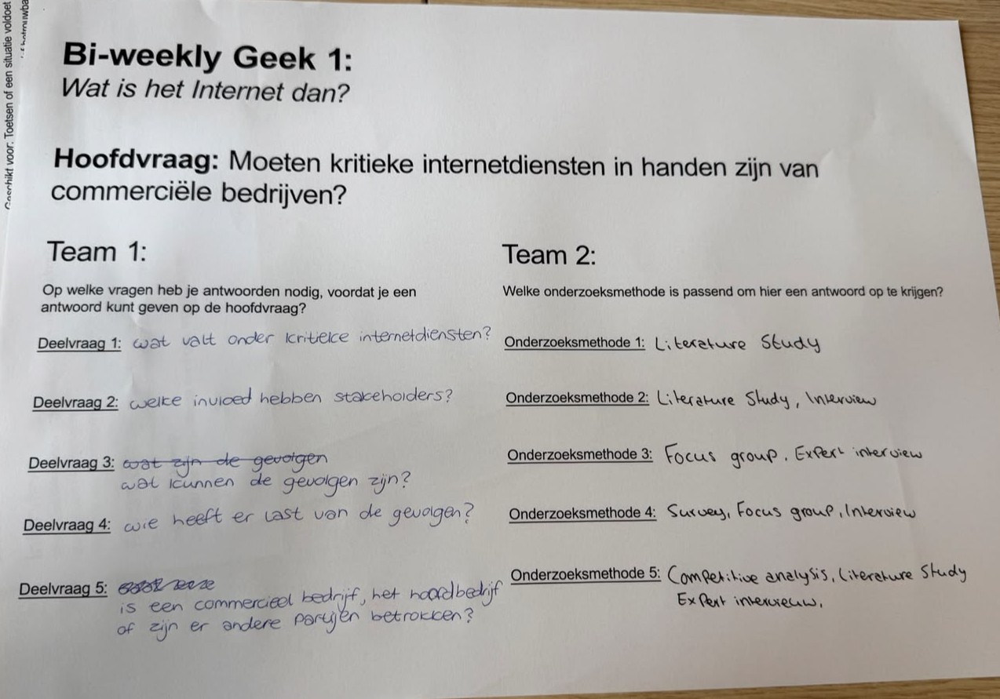

<strong> Opdracht 16: Tips lay-out in Duo's (Dewi)</strong>
Meer Afbeeldingen toevoegen, alles staat al goed centreert. Werken aan de lay-out

<strong> Opdracht 17: Responsive voorbeelden (Rianne) </strong>

1. Als je het kleiner maakt wordt de header aan de linker kant een menu gemaakt
2. UI design word minimaal gemaakt. Minder tekst meer knoppen om het clickable te maken.
3. Alles word kleiner, maar de tekst en afbeeldingen worden juist groter, om het zo duidelijk mogelijk te behouden.

<strong> Check-out met Tim & Rianne </strong>

1. Leg uit wanneer een website 'lelijk' wordt en geef voorbeelden wat je kan doen om deze 'lelijke' onderdelen te fixen?: Waneer er alleen een html pagina hebt zonder css, met display grid en eigen content

2. Vertel welke volgende stap je neemt om je website responsive te maken: Dat mijn header in klapt naar een menutje

3. Kun je het ontwerp en de bouw van je eigen Garden (zo uit je hoofd) onderbouwen in Webby vocabulair?: Ja, als ik de 6 onderwerpen erbij haal wel!

### 7 sept - Workshop 1

--Check out met Hiba:

1. Leg uit wat een digital garden is en waarom dat anders is dan een reguliere website:
2. Leg uit wat een website 'webby' maakt en welke websites jou het meeste inspireren:
3. Vertel waar jij mee aan de slag wilt gaan bij het maken van jouw eigen digital garden (let op: dit zijn jouw eerste ideeën, dit kan en mag veranderen in de loop van het programma:

Een fork van de model repository gemaakt en gepubliceerd via mijn eigen Github omgeving. Ook heb ik een domein naam gekoppeld aan een websiteadress, via alle stappen van DLO. Als laatste heb ik met de klasgenoot Ana uit klas 206 een Check out gedaan:

1. Leg uit wat een source hosting platform is en voor welke jij gekozen hebt: Github, waar je je eigen platform/website kan hosten.
2. Vertel welke domeinnaam jij gekozen hebt en hoe je die hebt gekoppeld aan jouw pagina: Ik heb teresaarchive.nl en Ana balkanbaddie.nl, via de stappen van DLO hebben we een IP adress kunnen koppelen.
3. Beschrijf hoe je aanpassingen aan jouw pagina kunt maken en hoe je er voor zorgt dat die op het web gepubliceerd worden: Je kan via Vscodium mijn tekst aanpassen en zou nog meer willen in de loop van Spint 0.

## - Responsive website

Ik ben verder gegaan met het realiseren van mijn website. Ik heb ervoor gezorgd dat de website responsive werkt op verschillende schermformaten.

Ik heb onder andere de afbeeldingen aangepast zodat ze op desktop en mobiel op een goede plek staan. Ook heb ik de navigatie aangepast voor kleinere schermen.

## 1 okt - Light en dark mode

Ik heb een light en dark mode toegevoegd aan mijn website. De gebruiker kan met de knop rechtsboven tussen de twee thema's wisselen.

Ik heb hiervoor CSS custom properties gebruikt en JavaScript gebruikt om het thema te veranderen.

## - Foto's rondom de CD

Ik heb de foto's rondom de CD geplaatst. Hiervoor heb ik de afbeeldingen met CSS op verschillende posities rondom het midden geplaatst.

Ik heb de posities steeds aangepast totdat de afbeeldingen goed rondom de CD stonden.

##  - Boogtekst

Ik heb de tekst "Neem een kijkje in mijn skypia" als een boog rondom de CD geplaatst.

Voor de SVG-boog heb ik uitleg van ChatGPT gebruikt om te begrijpen hoe de path-code werkt. 
Daarna heb ik de code aangepast voor mijn eigen ontwerp.

##  - proces

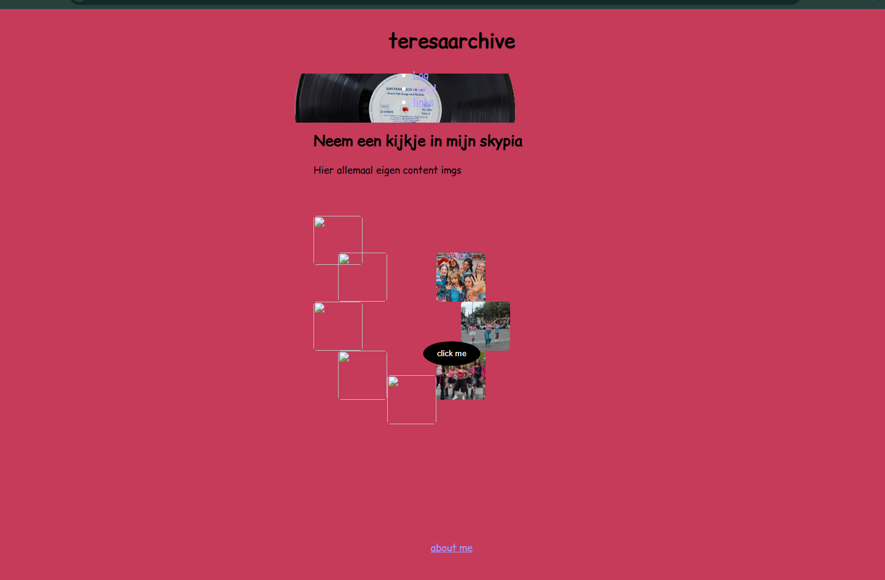

# Oefeningen

## Light & Dark

## Grid

## Gradients

## Button

BRONNEN
-themisozone youtube kanaal
-al mijn img zijn van mezelf
- ChatGPT: gebruikt als hulpmiddel om SVG-boogtekst te begrijpen. 

De voorbeelden en technieken die ik bespreek, zijn terug te vinden in mijn eigen website SKYPIA / Teresa Archive, in de HTML-, CSS- en JavaScript-bestanden.